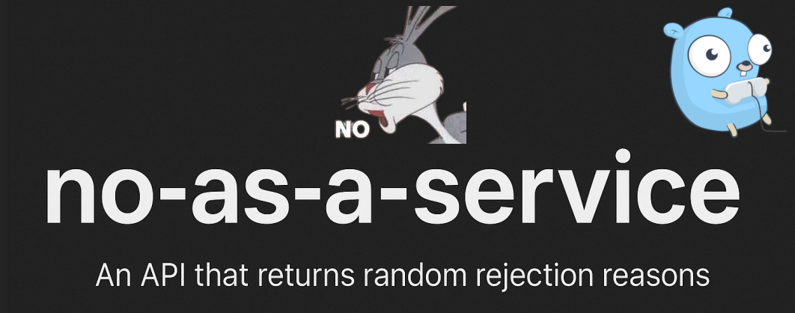

# ❌ No-as-a-Service-Go

<p align="center">
  
</p>

A tiny HTTP API that says **no** — returns a random, polite-but-firm rejection reason for any request. A Go port of [no-as-a-service](https://github.com/hotheadhacker/no-as-a-service) by [hotheadhacker](https://github.com/hotheadhacker), built on [Echo](https://echo.labstack.com).

Perfect for when you need to decline something with style and don't want to come up with the excuse yourself.

## 🚀 API Usage

| Method | Path  | Description                        |
| ------ | ----- | ---------------------------------- |
| `GET`  | `/no` | Returns a random rejection reason. |

```sh
curl http://localhost:<PORT>/no
```

### Example response

```json
{
  "reason": "This feels like something Future Me would yell at Present Me for agreeing to."
}
```

CORS is open (`*`) and requests are rate limited (20 burst, in-memory). Rejection reasons are loaded from `reasons.json` (1000+ entries) at startup. A ready-to-run request lives in `http/no.http`.

## 🛠️ Self-Hosting

The server reads the listen port from the `PORT` environment variable, so set one first (it won't start without it):

```sh
cp .env.example .env   # then set PORT=3000
```

**Build and run:**
```sh
make build-run
```

**Run with live reload** (watches `*.go` files and restarts on change):
```sh
make watch
```
If `wgo` is not installed, the target will prompt you to install it automatically.

**Run tests:**
```sh
make test
```

**Lint:**
```sh
make lint
```
If `golangci-lint` is not installed, the target will prompt you to install it automatically.

## 📁 Project Structure

```
.
├── cmd/app/main.go   # entry point: loads .env, reads reasons.json, starts Echo
├── reasons.json      # flat JSON array of 1000+ rejection reasons
├── http/no.http      # ready-to-run REST client request
├── .env.example      # PORT config
├── makefile          # build-run / watch / test / lint targets
└── cliff.toml        # git-cliff changelog config
```

## 📦 Dependencies

- [Echo v5](https://echo.labstack.com) - HTTP router and middleware
- [godotenv](https://github.com/joho/godotenv) - Loads `.env` config
- [wgo - watcher-go](https://github.com/bokwoon95/wgo) - Live reload for Go apps

Scaffolded from [go-tiny-boilerplate](https://github.com/viilis/go-tiny-boilerplate).

## 👤 Author

[viilis](https://github.com/viilis) — Go port. Original concept and reason data by [hotheadhacker](https://github.com/hotheadhacker). Gopher artwork by [Egon Elbre](https://github.com/egonelbre/gophers).

## 📄 License

[MIT](LICENSE) — the same license as the original [no-as-a-service](https://github.com/hotheadhacker/no-as-a-service).
